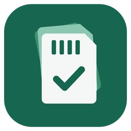
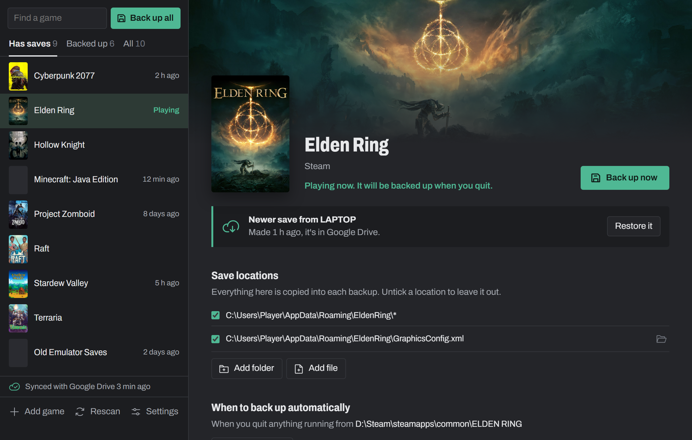
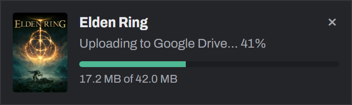

<p align="center">
  
</p>

<h1 align="center">Saveward</h1>

<p align="center">
  Your game saves, backed up the moment you quit.<br>
  A small Windows app that finds your saves, keeps versions of them, and copies them to your own Google Drive.
</p>

<p align="center">
  <a href="https://github.com/1Akeno/saveward/releases/latest"><b>Download for Windows</b></a>
  &nbsp;·&nbsp;
  <a href="https://1akeno.github.io/saveward/">Website</a>
  &nbsp;·&nbsp;
  <a href="https://1akeno.github.io/saveward/privacy.html">Privacy</a>
</p>

<p align="center">
  
</p>

## Why

Steam Cloud doesn't cover every game, Game Pass and older games often have no cloud saves at all,
and a corrupted save can wipe out a hundred hours. Saveward watches your games quietly from the tray
and makes a copy of your saves every time you stop playing. If something goes wrong, you pick a
backup and get your progress back.

## Features

- **Finds your saves for you.** Knows where tens of thousands of PC games keep their saves, using the
  [Ludusavi manifest](https://github.com/mtkennerly/ludusavi-manifest). Works with Steam, Epic, GOG,
  Xbox / Game Pass and games installed anywhere else.
- **Backs up when you quit.** Notices when a game closes and backs it up a few seconds later, only if
  something changed.
- **Keeps versions.** Every backup is a separate copy. Keep as many as you like, and pin the ones that
  matter so they're never cleaned up.
- **Safe restores.** Restoring always saves your current progress first, so a restore can't make
  things worse. Restoring is blocked while the game is running.
- **Google Drive in one click.** Sign in with Google and new backups upload by themselves. Saves made
  on your other PCs show up in each game's history, with a prompt when one is newer.
- **Back up everything** with one button, with a small progress pop-up for backups and uploads.
- **Your own games and folders.** Add any game, emulator or folder, change where a game saves, or
  leave a location out.
- **Light on your PC.** Lives in the tray at around 15 MB of memory. The window only uses more while
  it's open.
- Cover art from Steam (optional), light and dark mode, starts with Windows if you want it to.

<p align="center">
  
</p>

## Install

1. Download `Saveward_x.y.z_x64-setup.exe` from the [latest release](https://github.com/1Akeno/saveward/releases/latest).
2. Run it. It installs for your Windows account only and doesn't need admin rights.
3. Saveward scans for games on first launch. That takes a few seconds.

Requires Windows 10 or 11 (64-bit). The WebView2 runtime it uses is already part of Windows 11.

## How it works

**Finding saves.** Saveward reads which games Steam, Epic and GOG have installed, then checks the save
locations the Ludusavi manifest lists for each game. It also looks for saves of games that aren't
installed through a store, so games from other launchers or old installs are found too.

**Knowing when you quit.** Every few seconds it checks which programs are running. A game counts as
running when its program, or anything in its install folder, is open. For games installed elsewhere,
it recognizes the program by name or folder. You can always point it at the right program yourself.

**Backups.** Each backup is a zip file in `%APPDATA%\Saveward\backups\<game>`. Inside is a small
`saveward.json` file that records where every file belongs, written so the backup restores correctly
on another PC with a different user name or install drive.

**Cloud.** Backups upload to a `Saveward` folder in your Google Drive. Saveward uses Google's
`drive.file` permission, which only covers files Saveward created itself. It can't see anything else
in your Drive. Your sign-in is stored in Windows Credential Manager.

## Cloud providers

| Provider | Setup |
| --- | --- |
| Google Drive | Click **Sign in with Google**. Nothing else to do. |
| OneDrive | Needs a free Microsoft app registration. Saveward shows the steps. |
| Dropbox | Needs a free Dropbox app key. Saveward shows the steps. |

Builds can include their own OneDrive or Dropbox keys, so their users get one-click sign-in too
(see [Building](#building)).

## Your data

| What | Where |
| --- | --- |
| Settings and your custom games | `%APPDATA%\Saveward\settings.json` |
| Backups | `%APPDATA%\Saveward\backups\` (you can change this in Settings) |
| Save-location database | `%APPDATA%\Saveward\manifest.yaml`, refreshed weekly |
| Your cover images | `%APPDATA%\Saveward\covers\` |

Uninstalling Saveward keeps all of this, so your backups are never deleted by accident.
Saveward has no servers and collects no analytics. See the [privacy policy](https://1akeno.github.io/saveward/privacy.html).

## Building

You need [Rust](https://rustup.rs), [Node.js](https://nodejs.org) 20 or newer, and the
[Tauri prerequisites for Windows](https://tauri.app/start/prerequisites/).

```powershell
npm install
npm run tauri dev      # run in development
npm run tauri build    # installer in src-tauri/target/release/bundle/nsis/
```

### Cloud keys

Sign-in needs an app registration with each provider. Put yours in `src-tauri/cloud-keys.json`
(git-ignored) and they're built in automatically:

```json
{
  "google_id": "...apps.googleusercontent.com",
  "google_secret": "GOCSPX-...",
  "onedrive_id": "",
  "dropbox_key": ""
}
```

Or set `SAVEWARD_GOOGLE_ID`, `SAVEWARD_GOOGLE_SECRET`, `SAVEWARD_ONEDRIVE_ID` and
`SAVEWARD_DROPBOX_KEY` when building. Without keys, Saveward still works fully offline, and the Cloud
window shows users how to add their own.

| Provider | Registration |
| --- | --- |
| Google Drive | Google Cloud console: enable the Drive API, create an OAuth client of type *Desktop app*, publish the consent screen. Scope: `drive.file`. |
| OneDrive | Microsoft Entra *App registrations*: personal and work accounts, public client redirect `http://localhost`, delegated permission `Files.ReadWrite.AppFolder`. |
| Dropbox | Dropbox App Console: scoped access, *App folder*, `files.content.read` and `files.content.write`, redirect `http://127.0.0.1:47863/callback`. |

### Tests

```powershell
cd src-tauri
cargo test --lib                              # unit tests
cargo test --lib -- --ignored --nocapture     # also scans the games on this PC
```

`tools/e2e-autobackup.ps1` runs a fake game, closes it, and checks that Saveward backed it up and
showed its pop-up. It restores your settings afterwards.

## Project layout

```
src/                 window UI (TypeScript, no framework)
  main.ts            game list and game page
  cloud.ts           cloud sign-in window and cloud history
  popup.ts           progress pop-up
src-tauri/src/
  scan.rs            finding games and their save locations
  stores.rs          Steam, Epic and GOG installs
  manifest.rs        Ludusavi manifest download and parsing
  backup.rs          backups, versions and restores
  watcher.rs         noticing when a game closes
  cloud.rs           Google Drive, OneDrive and Dropbox
  sync.rs            upload queue and newer-save checks
  lib.rs             app, tray, commands
docs/                website and screenshots
tools/               test and screenshot helpers
```

## Credits

- Save locations: [Ludusavi manifest](https://github.com/mtkennerly/ludusavi-manifest) (MIT) by
  mtkennerly, built from [PCGamingWiki](https://www.pcgamingwiki.com).
- Built with [Tauri](https://tauri.app).
- Icons: [Phosphor Icons](https://phosphoricons.com) (MIT).
- Font: [Archivo](https://fonts.google.com/specimen/Archivo) (SIL Open Font License).
- Cover art is loaded from Steam and belongs to each game's publisher.

## License

[MIT](LICENSE)
